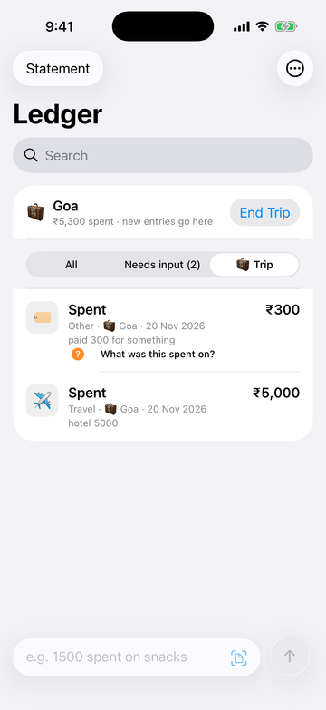
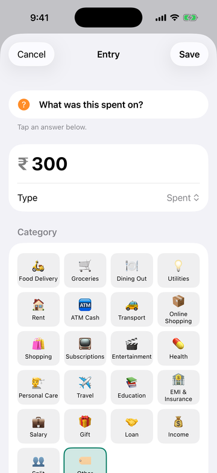
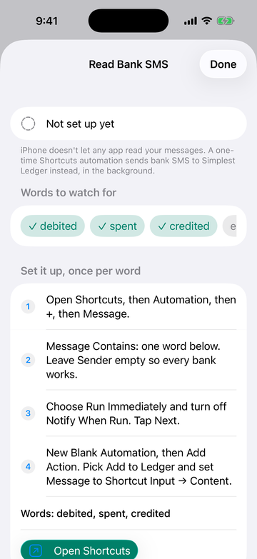

<p align="center"></p>

<h1 align="center">Simplest Ledger</h1>

<p align="center"><b>A private expense tracker for iPhone. Type it like a message.</b><br>
No account. No internet. No ads. Everything stays on your phone.</p>

<p align="center">




</p>

## Just type

```
1500 snacks via UPI
lent 2000 to Rahul
split the dinner with 3 people
going on goa trip
```

Amount, category, payment method and person are filled in for you. Anything unclear goes to **Needs input**, where you answer with a tap.

## Features

- 🧾 **Scan receipts** and UPI screenshots
- 📩 **Bank SMS**: debits and credits added automatically (one-time Shortcuts setup, in the app)
- 👥 **Split bills**: "he paid 700", "split with 3 people"; tracks who owes you
- 🤝 **Lend and borrow**, with running balances
- 🧳 **Trips**: group a trip's spending, see the total
- 📊 **Monthly statement** in plain text: by category, by payment method, who owes whom
- 🗂️ 20+ categories with icons; Dining Out, Food Delivery, Groceries, Utilities, Online Shopping…
- 🌗 Dark mode, Liquid Glass design, Hindi and Hinglish input with English output
- ⬇️ CSV export/import, auto-backup to an iCloud Drive or Google Drive folder you pick

## Private and secure by design

- **On-device only.** Your entries live in the app on your iPhone. No server, no cloud database.
- **No account, no sign-up, no tracking.** No analytics, no ads, no internet access in the app.
- **Smart parsing runs locally** with Apple Intelligence (iPhone 15 Pro or newer); otherwise a built-in offline parser.
- **Receipts are read on the phone** and not stored. Backups go only to a folder you choose.
- **Public code.** Read every line of it right here.

## Install (free, ~5 min)

1. Download **SimplestLedger.ipa** from [Releases](../../releases/latest).
2. Install it with [Sideloadly](https://sideloadly.io) (Windows/Mac) and a free Apple ID.
3. On the iPhone: Settings → General → VPN & Device Management → **Trust**. Turn on **Developer Mode** if asked.

Free Apple IDs re-sign every 7 days: repeat step 2 and your data stays.

<details>
<summary>More screenshots</summary>
<p>



</p>
</details>

<details>
<summary>Build from source</summary>

SwiftUI, iOS 26, no third-party dependencies. Every push builds an unsigned IPA on GitHub Actions (`.github/workflows/build.yml`) using [XcodeGen](https://github.com/yonaskolb/XcodeGen). Parsing logic lives in `LedgerCore` with tests: `swift test --package-path LedgerCore`.
</details>
