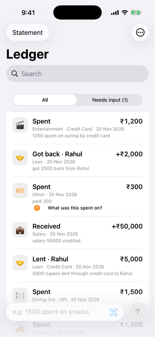
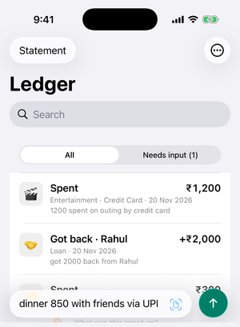
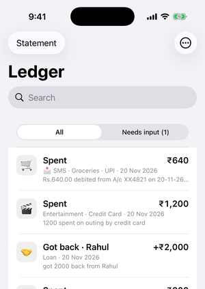
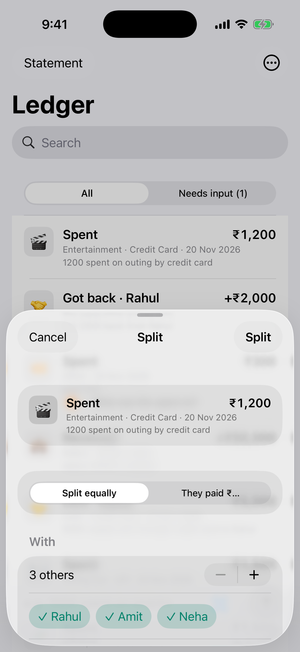
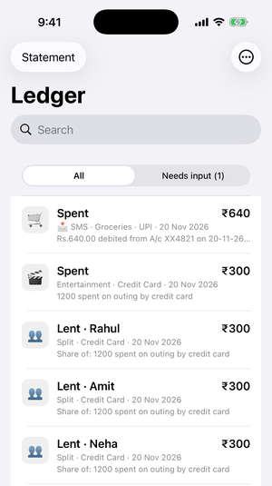
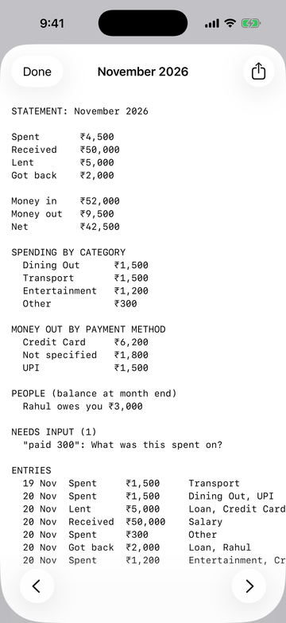
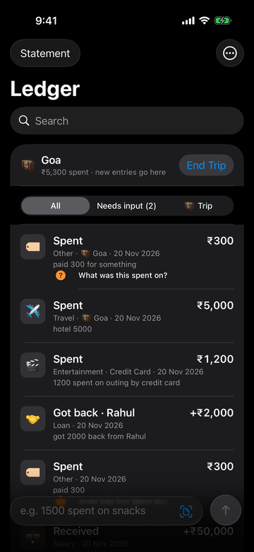
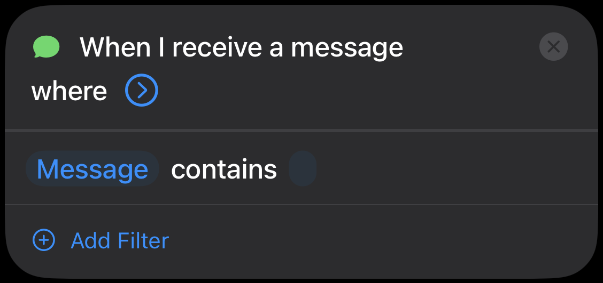
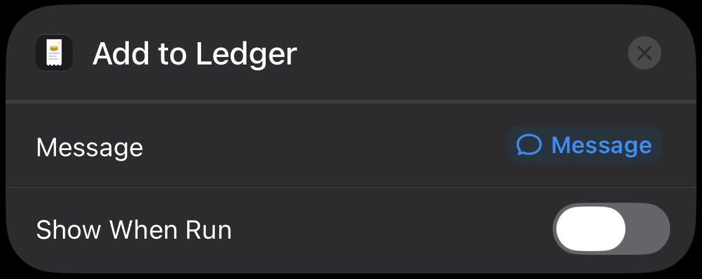
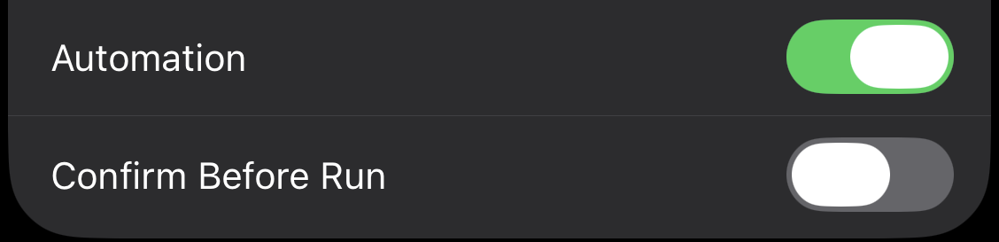

<h1 align="center">Simplest Ledger</h1>

<b>A private expense tracker for iPhone. Type it like a message.</b> 
No account · No internet · No ads · Everything stays on your phone

<a href="../../releases/latest"><b>⬇️ Download the app (free)</b></a>

---

<table>
<tr>
<td width="300"></td>
<td><h3>✍️ Just type</h3>
<code>dinner 850 with friends via UPI</code> 
Amount, category and payment method are filled in for you. English, Hindi or Hinglish.</td>
</tr>
<tr>
<td></td>
<td><h3>📩 Bank SMS, added for you</h3>
A UPI or card debit arrives and it's in your ledger, tagged <b>SMS</b>. OTPs, offers and failed payments are skipped. Any bank, any currency. <a href="#-bank-sms-setup-once-1-minute">One-time setup</a>.</td>
</tr>
<tr>
<td> </td>
<td><h3>👥 Edit old entries by typing</h3>
<code>split the outing with Rahul, Amit and Neha</code> 
Finds the ₹1,200 outing, asks once, then it becomes your ₹300 share and each friend owes you ₹300.</td>
</tr>
<tr>
<td></td>
<td><h3>❓ Unclear? Just tap</h3>
Anything the app isn't sure about goes to <b>Needs input</b>. Answer with one tap on an icon.</td>
</tr>
<tr>
<td></td>
<td><h3>🧳 Trips</h3>
<code>going on goa trip</code>: everything after is grouped, with a running total.</td>
</tr>
<tr>
<td></td>
<td><h3>📊 Monthly statement</h3>
Plain text: by category, by payment method, who owes whom. Copy or share.</td>
</tr>
<tr>
<td></td>
<td><h3>🌗 Also</h3>
🧾 Scan receipts and UPI screenshots · 🤝 Lend and borrow · 🔍 Search · ⬇️ CSV backup to iCloud or Google Drive · Dark mode</td>
</tr>
</table>

## 🔒 Private by design

- Everything is stored **on your iPhone**. No servers, no cloud database.
- **No account, no sign-up, no tracking, no ads.** The app never connects to the internet.
- Smart parsing runs **on the device** (Apple Intelligence on iPhone 15 Pro+, or a built-in offline parser).
- Receipts are read on the phone and never saved. Backups go only to a folder you pick.

## 📲 Install (free)

Pick one. Both use a free Apple ID; turn on **Developer Mode** on the iPhone (Settings → Privacy & Security).

**SideStore** (recommended: no computer after setup)
1. Once, on a Windows PC or Mac: install [SideStore](https://docs.sidestore.io) with **iloader** and a USB cable.
2. In SideStore → **Sources** → **+**, add: `https://github.com/vanshwason/simplest-ledger/releases/latest/download/sidestore.json`
3. Install **Simplest Ledger**. SideStore renews it every 7 days over Wi-Fi, and new versions show up as updates.

**Sideloadly** (computer every 7 days)
1. Download **SimplestLedger.ipa** from [Releases](../../releases/latest) and install it with [Sideloadly](https://sideloadly.io).
2. iPhone: Settings → General → VPN & Device Management → **Trust**.
3. Re-install every 7 days. Your data stays.

Switching between the two? Keep a backup first (menu → Backup folder): the app may install as a new copy.

**Works on** any iPhone with **iOS 26** (iPhone 11 or newer, SE 2nd gen or newer). Smarter parsing with Apple Intelligence on iPhone 15 Pro, all iPhone 16 and 17 models; other iPhones use the built-in offline parser. Tested on iPhone 16 Pro.

## 📩 Bank SMS setup (once, 1 minute)

iOS doesn't let apps read SMS, so a Shortcuts automation hands each message to the app. The app keeps only real transactions; chats, OTPs and offers are dropped.

1. **Shortcuts** → **+** → **Automation** → **Message**.
2. Change *Sender* to **Message contains**, and type **one space**. Every message has a space, so any bank and any currency works.

   
3. Tap **Search** at the bottom, type **Ledger**, pick **Add to Ledger**. Set *Message* to the blue **Message**. Turn **Show When Run** off.

   
4. Tap **›** next to *where*: **Automation** on, **Confirm Before Run** off.

   

On iOS 26: Shortcuts → **Automation** tab → **+** → **Message**, then the same settings, with **Run Immediately**.

---

Free for personal, non-commercial use under the [PolyForm Noncommercial License](LICENSE.md). Ideas and pull requests welcome: see [CONTRIBUTING](CONTRIBUTING.md).
